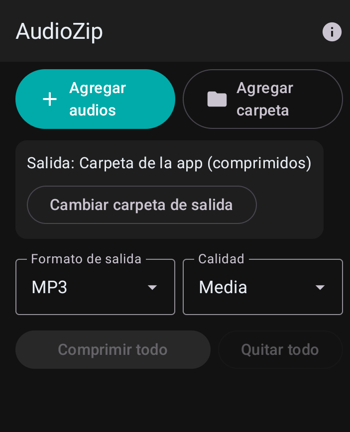
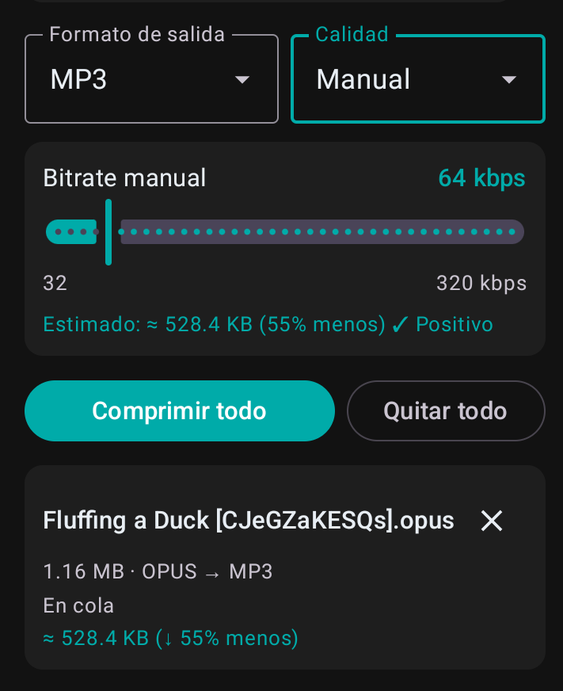

# AudioZip

  
  
  
  

<b>Comprime audios por lotes, recórtalos y únelos en tu teléfono, sin internet y conservando el nombre original de cada archivo.</b>

AudioZip es una app Android gratuita y de código abierto para reducir el peso de tus audios y armar tus propias mezclas: agrega archivos o carpetas enteras, elige formato y calidad, recorta secciones con la onda visual y exporta todo con el mismo nombre (solo cambia la extensión). Ideal para audios de videojuegos, música y grabaciones.

## ✨ Características

- 📦 **Compresión por lotes** con progreso por archivo
- ✂️ **Recortar y unir**: onda visual con marcadores arrastrables, campos de tiempo exactos, vista previa en bucle de la selección y lista de segmentos ordenable; une recortes de archivos y formatos distintos en un solo archivo
- ▶️ **Escucha antes y después**: reproduce el original y el resultado comprimido para comparar la calidad
- 🎚️ **Modo manual**: deslizador de bitrate (32–320 kbps) con estimación de tamaño y aviso de si la compresión conviene o pesaría más
- 📁 **Salida a la carpeta Música** por defecto (o a la carpeta que elijas): los archivos conservan su nombre, solo cambia la extensión
- 🔌 **Sin internet**: todo se procesa en el teléfono con ffmpeg-kit
- 🎨 **Material 3**, modo oscuro, interfaz en español
- ❓ **Ayuda integrada** que explica qué formato elegir y por qué a veces un archivo pesa más

## 🎧 Formatos y calidad

| Formato | Alta | Media | Baja |
|---|---|---|---|
| MP3 | 320 kbps | 192 kbps | 128 kbps |
| OGG (Vorbis) | q7 | q5 | q3 |
| Opus | 192 kbps | 128 kbps | 96 kbps |
| M4A (AAC) | 320 kbps | 192 kbps | 128 kbps |
| FLAC | nivel 8 | nivel 5 | nivel 0 |
| WAV | sin pérdida (pcm_s16le) | — | — |

Entrada y salida admiten **mp3, ogg, opus, wav, flac y m4a**. WAV y FLAC son sin pérdida: no comprimen, solo convierten.

## 🚀 Cómo usarla

### Comprimir

1. Toca **Agregar audios** o **Agregar carpeta**
2. Elige **formato de salida** y **calidad** (o modo **Manual** con el deslizador)
3. Toca **Comprimir todo**
4. Escucha el original y el resultado con los botones de reproducción, y compártelo o guárdalo en tu carpeta elegida

### Recortar y unir

1. En la pestaña **Recortar y unir**, agrega los audios
2. Arrastra los marcadores de la onda (o escribe los tiempos exactos) y toca **Agregar recorte a la lista**; si no quieres recortar, toca **Agregar audio completo a la lista**
3. Ordena los segmentos con las flechas y elige el formato de salida
4. Toca **Exportar unión** para obtener un solo archivo

## 📸 Capturas

<table>
  <tr>
    <td align="center"> Inicio</td>
    <td align="center"> Modo manual</td>
    <td align="center"> Ayuda</td>
  </tr>
</table>

## 📥 Instalación

Descarga el APK desde la pestaña **Actions** del repo: abre la compilación más reciente y baja el artefacto `compresor-audio-release-apk`. Instálalo en tu teléfono (Android 9.0 o superior) permitiendo orígenes desconocidos.

## 🔨 Compilar desde el código fuente

**Opción 1 — GitHub Actions (recomendado si no tienes Android Studio):**
el workflow `.github/workflows/build.yml` compila el APK en cada push. Descárgalo desde la pestaña **Actions** del repo.

**Opción 2 — Android Studio:**

1. Si compilas en local, copia `gradle-wrapper.jar` de un proyecto con Gradle 9.6.0 a `gradle/wrapper/` (el jar no se incluye en el repo).
2. Abre el proyecto y pulsa **Run**.

## 📄 Licencia

GPL-3.0. Puedes usar, copiar, modificar y distribuir el programa, siempre que las versiones modificadas también sean GPL-3.0 y el código fuente esté disponible.
